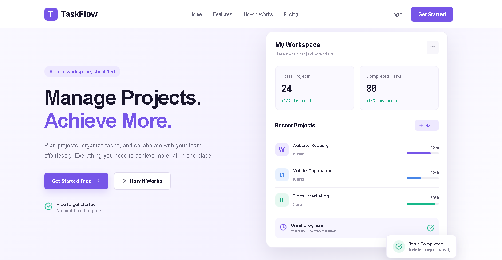
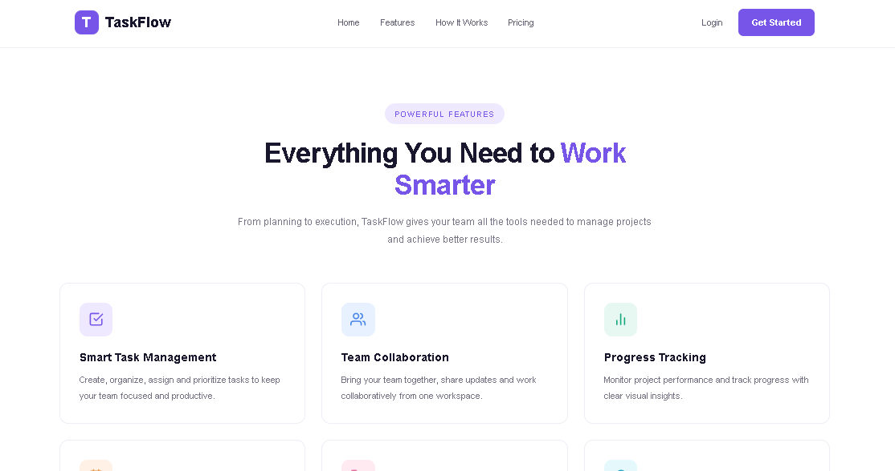
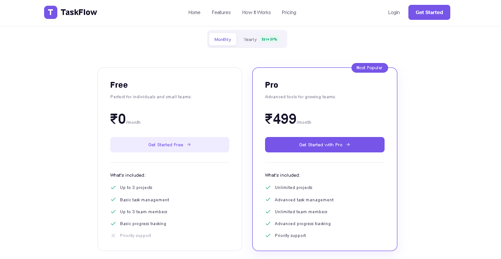
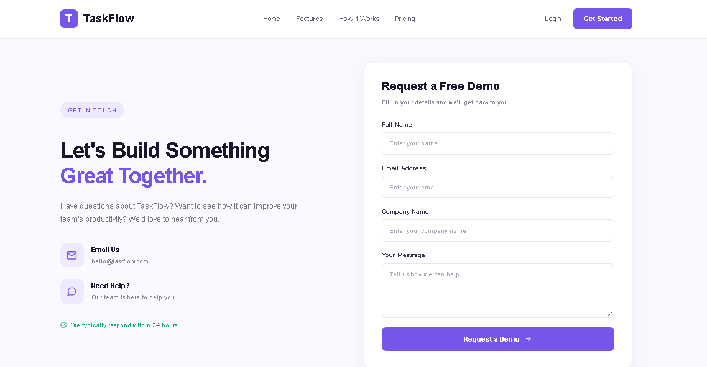
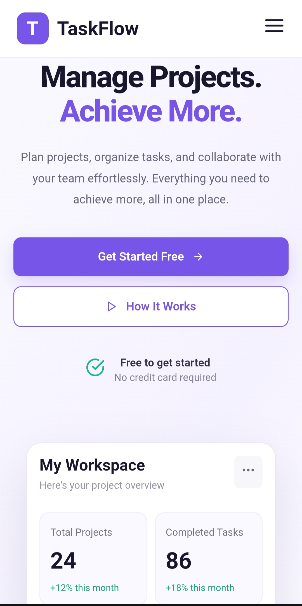
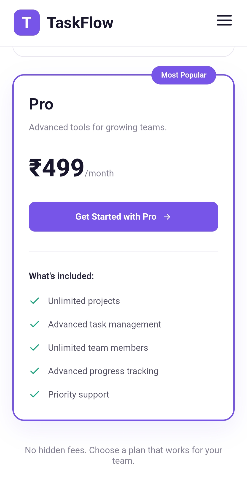
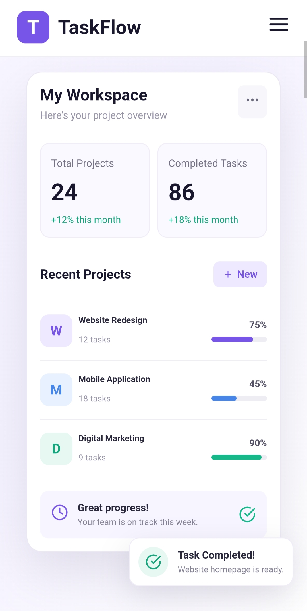

# TaskFlow – SaaS Project Management Landing Page

TaskFlow is a modern, responsive SaaS landing page for a smart project management platform. It is designed to help teams organize projects, manage tasks, track progress, and collaborate efficiently.

## 🌐 Live Demo

Visit TaskFlow: https://landing-page-taskflow.netlify.app/

## 📌 GitHub Repository

View Source Code: https://github.com/saurabh-2414/taskflow-landing-page

## ✨ Features

- **Responsive Navigation:** Mobile-friendly navigation with a hamburger menu.
- **Hero Section:** Attractive introduction with a dashboard-style preview.
- **Features Section:** Highlights six key project management features.
- **How It Works:** Explains the platform workflow in three simple steps.
- **Pricing Section:** Free and Pro plans with monthly and yearly billing options.
- **Contact Form:** Form validation with a success message.
- **Footer:** Social media links and useful navigation links.
- **Responsive Design:** Optimized layouts for desktop, tablet, and mobile devices.
- **Interactive Elements:** Smooth navigation, buttons, hover effects, and pricing toggle.

## 🛠️ Technologies Used

- React.js
- JavaScript (ES6+)
- HTML5
- CSS3
- React Icons
- React Hooks (`useState`)
- Vite
- Netlify (Deployment)
- Git and GitHub (Version Control)

## 📂 Project Structure

taskflow-landing-page/
├── public/
├── screenshots/
├── src/
│   ├── components/
│   │   ├── Navbar.jsx
│   │   ├── Navbar.css
│   │   ├── Hero.jsx
│   │   ├── Hero.css
│   │   ├── Features.jsx
│   │   ├── Features.css
│   │   ├── HowItWorks.jsx
│   │   ├── HowItWorks.css
│   │   ├── Pricing.jsx
│   │   ├── Pricing.css
│   │   ├── Contact.jsx
│   │   ├── Contact.css
│   │   ├── Footer.jsx
│   │   └── Footer.css
│   ├── App.jsx
│   ├── App.css
│   ├── index.css
│   └── main.jsx
├── index.html
├── package.json
└── README.md

## 🚀 Getting Started

Follow these steps to run the project locally.

### 1. Clone the repository

git clone https://github.com/saurabh-2414/taskflow-landing-page.git

### 2. Navigate to the project directory

cd taskflow-landing-page

### 3. Install dependencies

npm install

### 4. Start the development server

npm run dev

Open the local URL displayed in your terminal to view the application.

### 5. Create a production build

npm run build

## 🎨 Design Explanation

TaskFlow uses a clean and modern SaaS design with a white and light-lavender background, complemented by purple and blue accent colors.

The hero section features a dashboard-style preview to communicate the product concept visually. Consistent typography, rounded cards, subtle shadows, and spacing create a professional appearance.

The website is divided into reusable React components to maintain a clear and organized structure. CSS Grid, Flexbox, and media queries are used to create responsive layouts across different screen sizes.

Interactive elements such as the mobile navigation menu, pricing toggle, and contact form validation improve the user experience.

## 📱 Responsive Design

The website is designed to work across:

- Desktop screens
- Tablets
- Mobile devices

## 🖥️ Project Preview

### Desktop View

### Mobile View

## 📬 Contact

**Developer:** Saurabh Prajapati

- GitHub: https://github.com/saurabh-2414
- LinkedIn: https://www.linkedin.com/in/saurabh-prajapati-226066272/

---

**Note:** The contact form is a frontend demonstration. It performs client-side validation and displays a success message; it does not send or store form submissions.

**Built with React.js and CSS.**